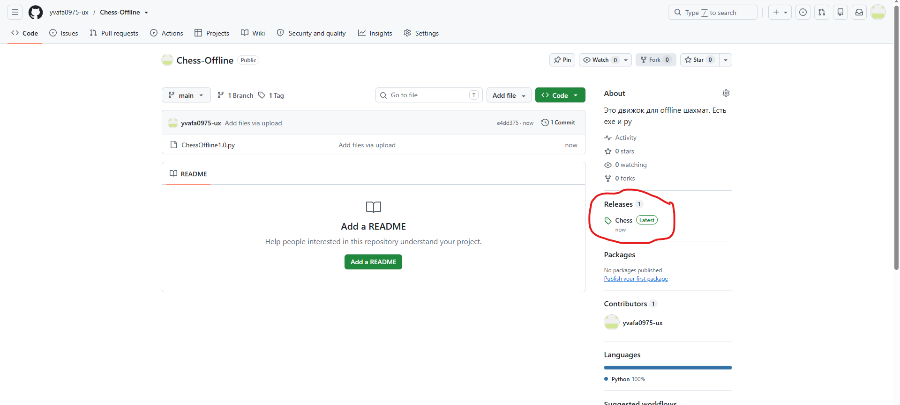
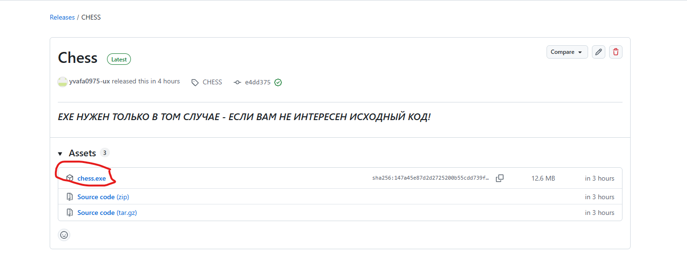
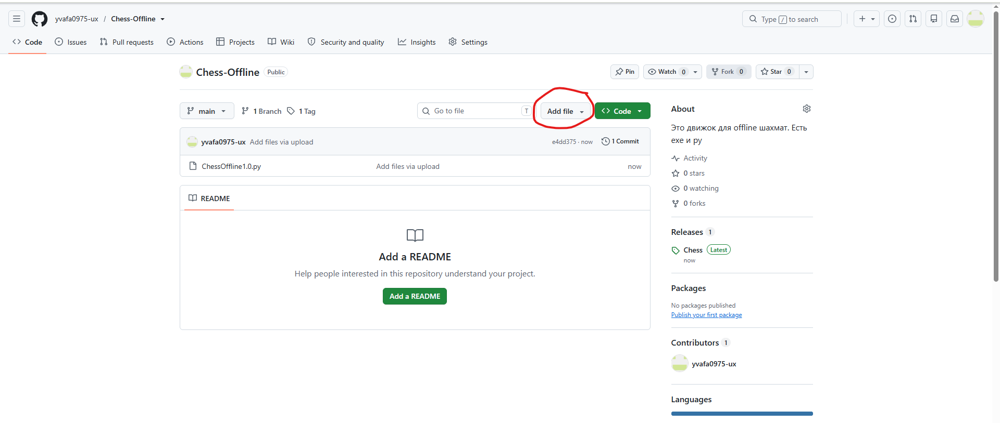

Перед началом извиняюсь перед прошлым редми:
ЗДРАВСТВУЙТЕ - ЕСЛИ ВЫ ХОТИТЕ ПОТРЕНИРОВАТЬСЯ, НО МЕШАЕТ СТРЕСС? ТЕБЕ СЮДА!

КАК ЖЕ УСТАНОВИТЬ ЭТУ ИМБУ

НАЖИМАЕШЬ НА РЕЛИЗЫ

И НАЖИМАЕШЬ НА Chess.exe

2) EXE ПОД 1.5 НЕ ОБНОВЛЕН!

И НАЖИМАЕШЬ download ZIP

ДАЛЬШЕ КАК ТЫ СКАЧАЛ ЭТУ ПАПКУ >>> ИЗВЛЕКАЙ ЕЕ НА РАБОЧИЙ СТОЛ

>>> ПОТОМ КАК ЭТО СДЕЛАЛ ТЕБЕ НУЖЕН ЛЮБОЙ КОДОВЫЙ РЕДАКТОР, МОЖНО ДАЖЕ PYTHON IDLE

КАК ТОЛЬКО ТЫ ЕГО СКАЧАЛ ТО ДЕЛАЙ ЭТО >>> НАЖИМАЙ НА АДРЕСС

И НАЖМИ BACKSCAPE И ПИШИУ ТУДА "cmd"

У ТЕБЯ СРАЗУ ОТКРЫВАЕТСЯ КОМАНДНАЯ СТРОКА И ЕСЛИ У ТЕБЯ НЕ УСТАНОВЛЕНА БИБЛИОТЕКА ДЛЯ EXE - ТО ВОТ КОМАНДА

>>> pip install pyinstaller
>>> python -m pip install pyinstaller(если версия не 1)

КАК ТОЛЬКО У ТЯ ПОШЛИ ЛОГИ - ЭТО ЗНАЧИТ ЧТО ТЫ СДЕЛАЛ ВСЕ ПРАВИЛЬНО!

ПОСЛЕ ЧЕГО ВВОДИШЬ ЭТУ КОМАНДУ 

>>> pip install pyinstaller && python -m PyInstaller --onefile --noconsole chess.py

У ТЕБЯ ПОЯВЛЯЕТСЯ build И dist

НАЖИМАЕШЬ НА dist И ТАМ EXE 

САМЫЙ ЛЕГКЙИ СПОСОБ ЗАПУСТИТЬ ИГРУ!

НАЖИМАЕШЬ НА АДРЕССНУЮ СТРОЧКУ - СТИРАЕШЬ И ПИШЕШЬ "cmd"

ПОСЛЕ ЧЕГО У ТЕБЯ ОТКРЫВАЕТСЯ КОМАНДНАЯ СТРОЧКА

ПИШЕШЬ ТУДА "python chess1.5.py" и И НАЖИМАЕШЬ ENTER!

ИМБА - ИГРА ЗАПУСТИЛАСЬ! СОХРАНЕНИЯ РАБОТАЮТ!

